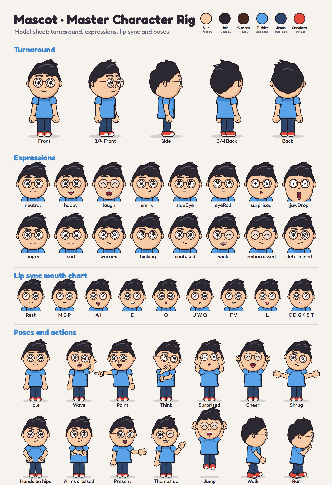

# Mascot: Master Character Rig

Rig karakter kartun 2D (vektor SVG) untuk Remotion. Identitasnya diambil dari foto referensi (pria berkacamata bulat, rambut hitam disisir ke atas dan ke samping) dengan outfit kaos santai, digambar dalam gaya chibi seperti character sheet referensi.

Karakter ini **satu komponen React**, bukan kumpulan gambar. Ekspresi, pose, arah hadap, kedip, bicara, dan jalan semuanya berupa props. Jadi setiap episode memakai rig yang sama dan identitas visualnya selalu konsisten.



## Isi folder

| File | Isi |
| --- | --- |
| `Character.tsx` | Komponen `<Character>`. Dibuat dengan `Interactive.create`, jadi semua kontrolnya bisa diedit dan di-keyframe di Remotion Studio. |
| `Head.tsx` | Kepala yang diproyeksikan seperti bola 3D: rambut (jambul menyapu ke samping), kacamata bulat, mata dengan kelopak, alis, hidung, telinga, 21 bentuk mulut. |
| `Body.tsx` | Kaos, lengan dengan lengan kaos, 5 bentuk tangan, jeans dengan lipatan, sneakers. |
| `presets.ts` | 16 ekspresi, 14 pose, dan fungsi blend. |
| `motion.ts` | Kedip otomatis, lip-flap saat bicara, siklus jalan/lari, napas saat diam, lambaian tangan. |
| `rig.ts` | Palet warna, proporsi tubuh, matematika 3D, kinematika (FK/IK), dan tipe data. |
| `model-sheet.png` | Model sheet: turnaround, ekspresi, chart mulut, dan pose. |

## Pemakaian dasar

```tsx
import {Character} from '../character';

<Character
  name="Host"
  from={0}
  durationInFrames={3 * fps}
  pose="wave"
  expression="happy"
  talking
  style={{translate: '540px 120px', scale: 0.9}}
/>
```

- Ukuran asli (framing `full`) adalah 840 × 900 px. Telapak kaki berada di 95,6% tinggi, dan itu juga titik pusat transform default, jadi `scale` membesar/mengecil dari kaki.
- Posisi diatur dengan `style.translate`, ukuran dengan `style.scale`. Keduanya juga bisa digeser langsung di Studio.
- Karena `Character` sudah berupa Sequence, ia menerima `from`, `durationInFrames`, dan `name`. Masukkan beberapa instance ke dalam `<Track>` untuk menyusun adegan.

## Props

| Prop | Default | Keterangan |
| --- | --- | --- |
| `expression` | `'neutral'` | Nama ekspresi atau objek `FaceSpec` kustom. |
| `expressionTo`, `expressionBlend` | `'neutral'`, `0` | Transisi halus ke ekspresi lain (0..1). |
| `pose` | `'idle'` | Nama pose atau objek `PoseSpec` kustom. |
| `poseTo`, `poseBlend` | `'idle'`, `0` | Transisi halus ke pose lain (0..1). |
| `talking` | `false` | Mulut bergerak otomatis (lip-flap) sambil kepala sedikit bergoyang. |
| `mouth` | `'auto'` | Paksa satu bentuk mulut, untuk lip sync manual. |
| `motion` | `'idle'` | `idle` (bernapas), `still` (diam total), `walk`, `run`. |
| `speed` | `1` | Kecepatan siklus jalan/lari. |
| `autoBlink` | `true` | Kedip otomatis tiap 2–5 detik, kadang kedip ganda. |
| `yaw` | `0` | Arah badan: `0` depan, `40` 3/4, `90` samping (hadap kanan), `180` belakang, `-90` hadap kiri. |
| `headYaw`, `headTilt`, `headNod` | `0` | Putar, miring, dan angguk kepala (derajat). |
| `lookX`, `lookY` | `0` | Arah lirikan pupil, -1..1. |
| `framing` | `'full'` | `full` (seluruh badan), `bust` (kepala + dada), `head` (kepala saja). |
| `seed` | `'mascot'` | Ubah jika ada 2 karakter dalam satu frame, supaya kedip/bicaranya tidak kembar. |

## Ekspresi (16)

`neutral` · `happy` · `laugh` · `smirk` · `sideEye` · `eyeRoll` · `surprised` · `jawDrop` · `angry` · `sad` · `worried` · `thinking` · `confused` · `wink` · `embarrassed` · `determined`

## Pose (14) dan gerak

`idle` · `wave` (melambai otomatis) · `point` (menunjuk ke kiri layar) · `pointRight` · `pointUp` · `think` · `surprised` · `cheer` · `shrug` · `handsOnHips` · `armsCrossed` · `present` · `thumbsUp` · `jump`

Ditambah `motion="walk"` dan `motion="run"`.

## Bentuk mulut (lip sync)

| Bunyi | `mouth` |
| --- | --- |
| diam | `rest` |
| M B P | `mbp` |
| A I | `aa` |
| E | `ee` |
| O | `oh` |
| U W Q | `oo` |
| F V | `fv` |
| L | `l` |
| C D G K N R S T Y Z | `etc` |

Bentuk ekspresif lain: `smile`, `neutral`, `flat`, `frown`, `smirk`, `wavy`, `open`, `grin`, `laugh`, `surprised`, `jawDrop`, `shout`.

- **Cepat:** `talking` selama karakter berbicara. Mulut berganti bentuk tiap ±0,1 detik.
- **Presisi:** set `mouth` per suku kata (keyframe di Studio, atau ganti nilainya dari kode berdasarkan frame).

## Transisi halus

```tsx
<Character
  pose="idle"
  poseTo="point"
  poseBlend={interpolate(frame, [1 * fps, 1.4 * fps], [0, 1], {
    extrapolateLeft: 'clamp',
    extrapolateRight: 'clamp',
  })}
  expression="neutral"
  expressionTo="happy"
  expressionBlend={interpolate(frame, [1 * fps, 1.3 * fps], [0, 1], {
    extrapolateLeft: 'clamp',
    extrapolateRight: 'clamp',
  })}
/>
```

## Berjalan dan berlari

`motion="walk"` menganimasikan langkah **di tempat**. Gerakkan karakter dengan `style.translate`. Supaya kaki tidak terlihat "meluncur", kecepatannya kira-kira **150 px/detik × speed × scale** untuk jalan dan 310 px/detik untuk lari. Gunakan `yaw={90}` untuk berjalan ke kanan dan `yaw={-90}` ke kiri.

## Kustomisasi

- **Warna** (misalnya kaos edisi khusus): ubah `COLORS` di `rig.ts`.
- **Pose baru:** kirim objek `PoseSpec`. Lengan bisa diatur dengan sudut (FK: `lift`, `swing`, `bend`, `twist`) atau dengan target posisi tangan (IK: `target`, `pole`).
- **Ekspresi baru:** kirim objek `FaceSpec`, atau turunkan dari preset.

```tsx
import {Character, EXPRESSIONS, POSES} from '../character';

<Character
  pose={{...POSES.idle, armL: {target: [70, -470, 80], hand: 'point'}}}
  expression={{...EXPRESSIONS.happy, lookX: -0.6}}
/>
```

Satuan rig: kepala berjari-jari 160 px, tanah di y = 0, dan y negatif mengarah ke atas. Target IK `[x, y, z]`: x = jarak ke luar dari garis tengah badan, z = ke depan.

## Komposisi di Studio (`npm run dev`)

- **Mascot / MascotRig**: playground rig. Pilih karakter, lalu atur ekspresi, pose, arah hadap, dan lainnya dari panel kontrol.
- **Mascot / RigDemo**: contoh video 18 detik (bicara + melambai, turnaround 360°, berjalan, menunjuk, terkejut, berpikir).
- **Mascot / ModelSheet**: sumber `model-sheet.png`.

## Render

```bash
npx remotion still ModelSheet character/model-sheet.png
npx remotion render RigDemo out/rig-demo.mp4
```

Jangan menamai komposisi `Character`. Di Windows nama itu bentrok dengan folder `character/` saat render lewat CLI.
