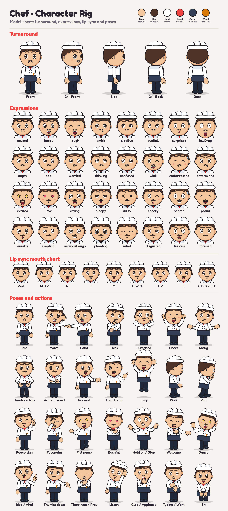

# Chef: Culinary Analogy Character Rig (`character/chef`)

Rig karakter **Koki / Chef** 2D (vektor SVG) untuk Remotion, dirancang khusus untuk **perumpamaan (*analogy*) dalam video tutorial coding & teknologi** (misalnya menganalogikan server/SSR seperti dapur restoran, *request queue*, *rate limiting*, *caching*, atau *multitasking*) maupun drama/sketsa.

## Identitas & Panduan Peran (Reusable di Berbagai Plot)

- **Persona & Ciri Visual**: Hangat, ekspresif, energik, dan bersahabat—memiliki **postur wajah bulat-hangat dengan pipi tembem**, kumis melengkung khas koki, topi koki berlipat (*toque*), seragam putih kancing ganda, syal merah, celemek abu-abu gelap, serta spatula kayu di saku.
- **Cocok digunakan untuk**:
  - **Perumpamaan Tutorial Coding**: Menjelaskan konsep **SSR vs CSR** (koki memasak di dapur vs mengirim bahan mentah), **Message Queue / Async**, **Cache** (menyiapkan bahan terlebih dahulu), atau **Load Balancer** (membagi pesanan ke beberapa koki).
  - **Problem Solving Analogi**: Menggambarkan kenapa *bottleneck* terjadi ketika "satu koki harus melayani seribu pesanan sekaligus".
  - **Fakta Menarik & Edutainment**: Pembawa segmen eksperimen/resep langkah demi langkah (*"Resep membuat website cepat"*).
  - **Drama & Sketsa**: Bisa menjadi koki di restoran tempat tim developer makan siang atau karakter metafora di adegan *cutaway*.
- **Kombinasi Pose & Ekspresi Andalan**:
  - Menyajikan hasil / "Pesanan siap!": `pose="present"` + `expression="proud"`
  - Kewalahan pesanan masuk (*high traffic*): `pose="surprised"` + `expression="worried"`
  - Menjelaskan alur dapur / *pipeline*: `pose="pointRight"` + `expression="happy"` + `talking`
  - Ide resep / optimasi baru: `pose="idea"` + `expression="eureka"`
- **Chemistry Terbaik**: Sangat cocok dipasangkan dengan **Man** (sebagai pelanggan yang memesan) atau **Backend Programmer** (sebagai versi metafora dari server).

## Props khusus karakter

| Prop | Default | Keterangan |
| --- | --- | --- |
| `showHat` | `true` | Tampilkan/sembunyikan topi koki (*toque*). |
| `showMustache` | `true` | Tampilkan/sembunyikan kumis koki. |
