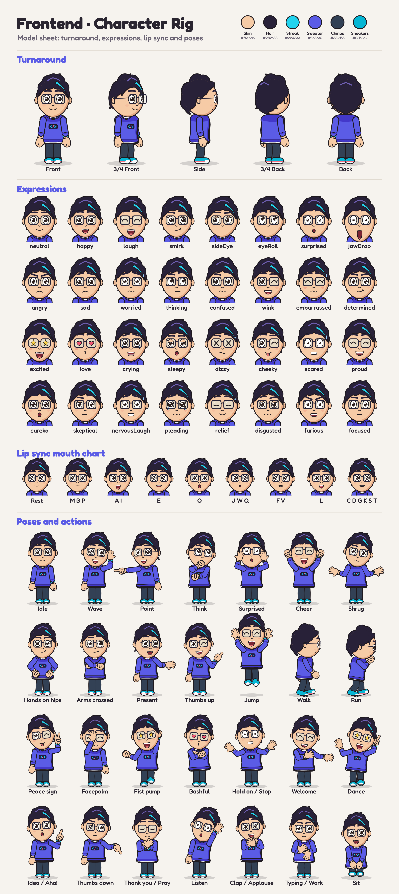

# Frontend Programmer: Master Character Rig (`character/frontend_programmer`)

Rig karakter **Programmer Frontend** 2D (vektor SVG) untuk Remotion. Didesain dengan tampilan modern kreatif: rambut medium berlayer dengan *highlight* electric-cyan, kacamata *rounded-square*, sweater indigo berlapis kaos putih dengan lencana `</>` di dada, jam tangan pintar (*smartwatch*) cyan di pergelangan kiri, celana chino slate, serta *sneakers* cyan beraksen coral.

Karakter ini memiliki antarmuka props yang **100% kompatibel** dengan [`../man`](../man/README.md) & [`../woman`](../woman/README.md), mendukung **32 ekspresi**, **28 pose**, **24 bentuk mulut (lip-sync)**, dan **5 siklus gerak (`idle`, `still`, `walk`, `run`, `dance`)**.



## Identitas & Panduan Peran (Reusable di Berbagai Plot)

- **Persona & Ciri Visual**: Kreatif, ekspresif, berorientasi visual, dan teliti terhadap pengalaman pengguna (rambut berlayer dengan *highlight* electric-cyan, kacamata *rounded-square*, sweater indigo berlapis kaos putih berlogo `</>`, lengan 3/4, dan *smartwatch* cyan).
- **Cocok digunakan untuk**:
  - **Tutorial Coding Frontend & UI**: Membahas HTML, CSS, Tailwind, React, Next.js, animasi web/Remotion, *state management*, atau komponen interaktif.
  - **Problem Solving Client-Side**: Membedah bug tampilan (*layout shift*, CSS responsif rusak, *re-render* berlebih, *CORS*, *hydration mismatch*, atau performa browser).
  - **Fakta Menarik Dunia Web**: Fakta sejarah browser, trik CSS unik, evolusi JavaScript, dan tren desain UI/UX.
  - **Drama & Sketsa**: Berperan sebagai developer yang paling pusing saat desain berubah di menit akhir, berdebat dengan **Backend** soal format response API, atau panik ketika **Bos** minta *"animasinya dibikin lebih wah"*.
- **Kombinasi Pose & Ekspresi Andalan**:
  - Fokus membangun UI / coding: `pose="typing"` + `expression="focused"`
  - Stres lihat tampilan berantakan di browser lain: `pose="facepalm"` + `expression="embarrassed"`
  - Menunjukkan fitur / animasi baru: `pose="pointRight"` + `expression="excited"`
  - Mendengar permintaan fitur dadakan: `pose="listen"` + `expression="skeptical"`
- **Chemistry Terbaik**: Sangat kuat sebagai rival komedi sekaligus partner kerja **Backend Programmer**, atau menjadi pihak yang menerima instruksi mendadak dari **Bos**.

## Isi folder

| File | Isi |
| --- | --- |
| `Character.tsx` | Komponen `<Character>` (`FrontendProgrammerCharacter`) dengan `Interactive.create` untuk kontrol & keyframe di Remotion Studio. |
| `Head.tsx` | Kepala 3D berlapis rambut berlayer dengan highlight cyan dan kacamata *rounded-square* (opsional via `showGlasses`). |
| `Body.tsx` | Sweater lengan 3/4 di atas kaos putih, lencana `</>` (opsional via `showBadge`), smartwatch, chino, dan sneakers. |
| `rig.ts` | Palet warna `COLORS` dan proporsi `RIG`. |
| `presets.ts` | Re-export 32 ekspresi, 28 pose, dan fungsi blending (`mixFace`, `resolveFace`, `resolvePose`). |
| `motion.ts` | Re-export kedip otomatis, lip-flap, serta siklus `idle`, `walk`, `run`, `dance`. |
| `model-sheet.png` | Model sheet: turnaround 360°, 32 ekspresi, chart mulut, dan 28 pose/aksi. |

## Pemakaian dasar

```tsx
import {Character as FrontendProgrammerCharacter} from '../character/frontend_programmer';
// atau: import {FrontendProgrammerCharacter} from '../character';

<FrontendProgrammerCharacter
  name="Frontend Dev"
  from={0}
  durationInFrames={3 * fps}
  pose="typing"
  expression="focused"
  talking
  style={{translate: '360px 120px', scale: 0.9}}
/>
```

## Props khusus karakter

Selain seluruh props standar (`expression`, `pose`, `talking`, `mouth`, `motion`, `yaw`, `headYaw`, `headTilt`, `headNod`, `lookX`, `lookY`, `framing`, `seed`, `style`), tersedia pula opsi berikut:

| Prop | Default | Keterangan |
| --- | --- | --- |
| `showGlasses` | `true` | Tampilkan/sembunyikan kacamata *rounded-square*. |
| `showBadge` | `true` | Tampilkan/sembunyikan emblem `</>` di dada. |

## Komposisi di Studio (`npm run dev`)

- **Mascot / FrontendProgrammerRig**: playground rig untuk mengatur ekspresi, pose, arah hadap, dan properti lainnya di Remotion Studio.
- **Mascot / FrontendProgrammerModelSheet**: sumber `model-sheet.png`.
