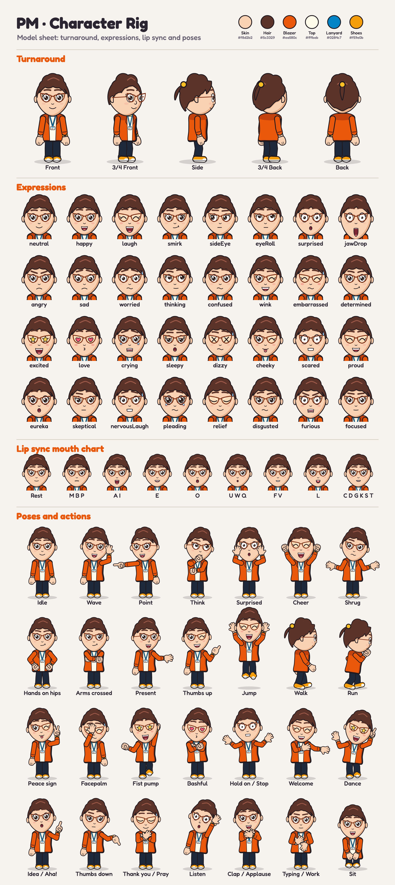

# Project Manager: Agile Coordinator Character Rig (`character/project_manager`)

Rig karakter **Project Manager (PM)** 2D (vektor SVG) untuk Remotion. Memiliki **postur wajah diamond dengan dagu V (*V-chin*) yang energik**, mata cerah berkarakter, kacamata *cat-eye*, kuncir kuda tinggi dengan ikat rambut emas, cardigan blazer terracotta di atas turtleneck krem, *lanyard* ID kantor, dan *smartwatch*.

## Identitas & Panduan Peran (Reusable di Berbagai Plot)

- **Persona & Ciri Visual**: Komunikatif, sigap, terorganisir, namun sering menjadi pembawa *requirement* atau perubahan jadwal mendadak—identik dengan *lanyard* kantor, blazer terracotta, dan gaya rambut kuncir kuda energik.
- **Cocok digunakan untuk**:
  - **Drama & Sketsa Perkantoran**: Membawa pesan *"Klien minta tambah satu fitur kecil sebelum demo besok"*, menyusun timeline sprint, atau menengahi keinginan **Bos** vs kapasitas tim dev.
  - **Tutorial Manajemen Proyek & Workflow**: Menjelaskan Agile/Scrum, Kanban, Git workflow tim, prioritas fitur, atau manajemen risiko proyek.
  - **Problem Solving Produk**: Membahas kenapa proyek sering molor, *scope creep*, atau miskomunikasi antara kebutuhan user dan implementasi teknis.
  - **Fakta Menarik Dunia Startup**: Mengulas cara kerja tim produk modern di balik aplikasi populer.
- **Kombinasi Pose & Ekspresi Andalan**:
  - Menyampaikan agenda / *sprint planning*: `pose="present"` + `expression="happy"` + `talking`
  - Membawa revisi dadakan dari klien: `pose="welcome"` + `expression="nervousLaugh"`
  - Kewalahan menjaga deadline tetap aman: `pose="facepalm"` + `expression="worried"`
  - Merayakan rilis tepat waktu: `pose="cheer"` + `expression="excited"`
- **Chemistry Terbaik**: Efektif berada di tengah antara **Boss** (pemberi target) dan **Tech Lead / Frontend / Backend / QA** (tim eksekusi).

## Props khusus karakter

| Prop | Default | Keterangan |
| --- | --- | --- |
| `showGlasses` | `true` | Tampilkan/sembunyikan kacamata *cat-eye*. |
| `showLanyard` | `true` | Tampilkan/sembunyikan *lanyard* & kartu ID PM. |
