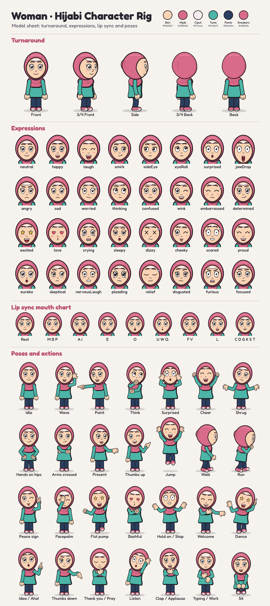

# Woman: Hijabi Master Character Rig (`character/woman`)

Rig karakter wanita berhijab 2D (vektor SVG) untuk Remotion. Mengenakan hijab *dusty rose* dengan ciput (*inner underscarf*), bros emas, tunik lengan panjang *teal/sage*, celana panjang *navy*, dan *sneakers* senada.

Karakter ini memiliki antarmuka props yang **100% identik** dengan karakter lain di [`../man`](../man/README.md), mendukung **32 ekspresi**, **28 pose**, **24 bentuk mulut (lip-sync)**, dan **5 siklus gerak (`idle`, `still`, `walk`, `run`, `dance`)**.



## Identitas & Panduan Peran (Reusable di Berbagai Plot)

- **Persona & Ciri Visual**: Sosok yang tenang, terstruktur, hangat, dan berwibawa secara intelektual (hijab *dusty rose* dengan bros emas, tunik teal rapi, wajah oval lembut dengan ekspresi mata berkarakter).
- **Cocok digunakan untuk**:
  - **Mentor / Educator Utama**: Paling pas untuk **tutorial coding**, **problem solving** langkah demi langkah, maupun **bedah arsitektur** karena pembawaannya yang rapi dan meyakinkan.
  - **Analis / Fact-Checker**: Cocok dalam konten **fakta menarik** atau *myth-busting* untuk meluruskan kesalahpahaman teknis secara jelas.
  - **Drama & Sketsa**: Bisa berperan sebagai **Tech Lead / Product Manager / QA / Senior Mentor** yang menjadi penengah logis di tengah kepanikan tim atau perdebatan Frontend vs Backend.
- **Kombinasi Pose & Ekspresi Andalan**:
  - Menyapa audiens / pembuka materi: `pose="welcome"` + `expression="happy"` + `talking`
  - Memaparkan alur solusi / perbandingan: `pose="present"` + `expression="determined"`
  - Menekankan poin penting / kunci masalah: `pose="pointUp"` + `expression="eureka"`
  - Membantah mitos atau menanggapi drama dengan tenang: `pose="armsCrossed"` + `expression="smirk"`
- **Chemistry Terbaik**: Efektif dipasangkan dengan **Man** (sebagai mentor yang menjawab pertanyaan) atau menjadi penengah antara **Boss**, **Frontend**, dan **Backend**.

## Pemakaian dasar

```tsx
import {Character as WomanCharacter} from '../character/woman';
// atau: import {WomanCharacter} from '../character';

<WomanCharacter
  name="Co-Host"
  from={0}
  durationInFrames={3 * fps}
  pose="welcome"
  expression="happy"
  talking
  style={{translate: '880px 120px', scale: 0.9}}
/>
```

