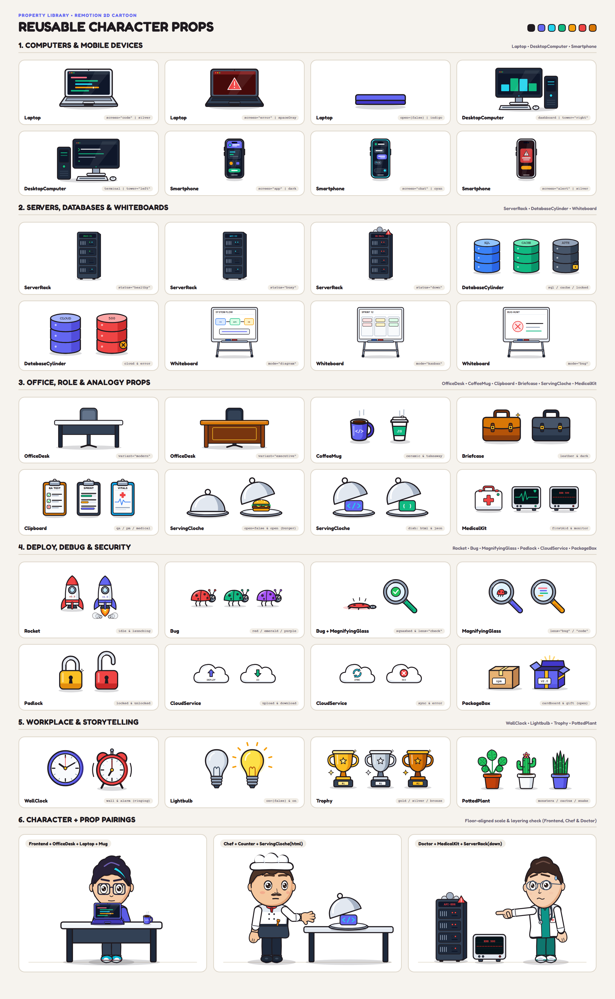

# Reusable Character Properties (`property/`)

Koleksi **22 properti kartun vektor 2D** bergaya Remotion (`#1f1a1f` bold outline, cel shading, interaktif di Remotion Studio melalui `Interactive.create`, dan animasi deterministik berbasis `useCurrentFrame()`) yang dirancang agar bisa dipasangkan dengan **karakter apa pun** di folder `character/`.



## Daftar Properti & Variannya

| Komponen | Kegunaan Utama | Props & Varian Penting | Cocok untuk Karakter |
| --- | --- | --- | --- |
| `Laptop` | Ngoding, bug emergency, presentasi | `screen` (`code`, `terminal`, `browser`, `dashboard`, `error`, `loading`, `off`), `color`, `badge`, `open`, `animated` | Frontend, Backend, Fullstack, Hacker, PM |
| `DesktopComputer` | Setup workstation penuh & monitoring | `screen` (sama seperti Laptop), `towerSide` (`right`, `left`, `none`), `accentColor`, `animated` | Backend, Tech Lead, Fullstack, Hacker |
| `ServerRack` | Rak server produksi, load & outage | `status` (`healthy`, `busy`, `warning`, `down`), `label`, `animated` | Backend, Tech Lead, Hacker, Doctor (health check) |
| `DatabaseCylinder` | Visualisasi penyimpanan data, cache, auth | `variant` (`sql`, `cache`, `cloud`, `locked`, `error`), `label`, `animated` | Backend, Fullstack, Tech Lead, Boss |
| `OfficeDesk` | Meja kerja modern / meja bos eksekutif | `variant` (`modern`, `executive`, `minimal`), `showChair` | Semua karakter (set `showChair={false}` bila karakter duduk di belakang meja) |
| `Whiteboard` | Penjelasan arsitektur, sprint, debugging | `mode` (`diagram`, `kanban`, `code`, `bug`, `clean`), `title` | Tech Lead, PM, QA, Man, Woman |
| `Smartphone` | Demo UI mobile, notifikasi darurat, chat | `screen` (`app`, `chat`, `alert`, `loading`, `off`), `frameColor` (`dark`, `silver`, `cyan`), `animated` | Frontend, PM, Boss, Fullstack |
| `CoffeeMug` | Pelengkap meja kerja & scene lembur | `variant` (`ceramic`, `takeaway`), `color` (`indigo`, `emerald`, `crimson`, `white`, `amber`), `label`, `steam` | Programmer, Tech Lead, Boss, Man, Woman |
| `Clipboard` | Checklist bug, sprint tracking, rekam medis | `variant` (`qa`, `pm`, `medical`), `title` | Quality Assurance, Project Manager, Doctor |
| `Briefcase` | Simbol bisnis, KPI, rapat klien/direksi | `variant` (`leather`, `dark`), `withGoldShine` | Boss, Project Manager |
| `ServingCloche` | Properti analogi dapur saat tutorial coding | `open`, `dish` (`burger`, `html`, `json`), `animated` | Chef (analogi HTML/API payload/restoran) |
| `MedicalKit` | Properti analogi diagnosa & kesehatan sistem | `variant` (`firstAid`, `monitor`), `healthy`, `animated` | Doctor (analogi debugging & server health check) |
| `Rocket` | Deploy, rilis versi, launch produk | `color` (accent*), `label`, `launching` (api + asap + getar), `animated` | Fullstack, Tech Lead, PM, Boss |
| `Bug` | Bug software berbentuk kumbang | `color` (accent*), `state` (`alive`, `squashed`), `animated` (kaki bergerak) | QA, Frontend, Backend, Hacker |
| `MagnifyingGlass` | Inspeksi, debugging, pencarian | `lens` (`empty`, `bug`, `code`, `check`), `handleColor` (accent*), `animated` | QA, Tech Lead, Doctor |
| `Padlock` | Keamanan, auth, enkripsi, breach | `locked`, `color` (`gold`, `silver`, accent*), `animated` | Hacker, Backend, Tech Lead |
| `CloudService` | Cloud upload/download/sync, outage | `status` (`online`, `upload`, `download`, `sync`, `error`), `label`, `animated` (melayang) | Backend, Fullstack, Tech Lead |
| `PackageBox` | Paket npm, artefak rilis, kiriman, hadiah | `variant` (`cardboard`, `gift`), `open` (flap + sinar), `label`, `animated` | Frontend, Fullstack, PM, Boss |
| `WallClock` | Deadline, lembur, waktu berlalu | `variant` (`wall`, `alarm`), `color` (accent*), `hours`, `minutes`, `fastForward`, `ringing` | PM, Boss, semua karakter |
| `Lightbulb` | Momen "aha!" / ide | `on`, `animated` (glow berdenyut) | Semua karakter (taruh di atas kepala) |
| `Trophy` | Pencapaian, sprint sukses, juara | `variant` (`gold`, `silver`, `bronze`), `label`, `sparkle` | Boss, PM, semua karakter |
| `PottedPlant` | Dekorasi kantor / rumah | `variant` (`monstera`, `cactus`, `snake`), `potColor` (`terracotta`, `white`, `indigo`), `animated` | Set dressing untuk scene mana pun |

\* accent = `indigo`, `red`, `emerald`, `amber`, `purple`, `cyan` (palet bersama `ACCENTS` di `shared.tsx`).

---

## Cara Menggunakan & Memasangkan dengan Karakter

Semua properti dan karakter bisa di-import langsung dari barrel root:

```tsx
import {
	ChefCharacter,
	DoctorCharacter,
	FrontendProgrammerCharacter,
	BackendProgrammerCharacter,
} from '../character';
import {
	CoffeeMug,
	Laptop,
	MedicalKit,
	OfficeDesk,
	ServerRack,
	ServingCloche,
} from '../property';
```

### 1. Karakter Mengetik di Meja Kerja (`pose="typing"`)

Karakter di `character/` memakai `transformOrigin: '420px 860px'` (titik lantai tepat di bawah sepatu) dan posisi tangan `typing` di `y = -285` dari lantai. Agar tinggi lantai karakter dan kaki meja sejajar sempurna di posisi `Y_LANTAI` berapa pun skalanya:
- Posisikan karakter dengan `left = centerX - 420` dan `top = Y_LANTAI - 860`.
- Posisikan `<OfficeDesk showChair={false} />` di depan karakter dengan `transformOrigin: '280px 340px'`, `left = centerX - 280`, dan `top = Y_LANTAI - 340`.
- Letakkan `<Laptop />` dan `<CoffeeMug />` di atas permukaan meja (`Y_LANTAI - 202 * deskScale`).

```tsx
const FLOOR_Y = 760;

<div style={{position: 'relative', width: 900, height: 820}}>
	<FrontendProgrammerCharacter
		pose="typing"
		expression="focused"
		style={{position: 'absolute', left: 450 - 420, top: FLOOR_Y - 860, scale: 0.8}}
	/>
	<div
		style={{
			position: 'absolute',
			left: 450 - 280,
			top: FLOOR_Y - 340,
			transform: 'scale(1.14)',
			transformOrigin: '280px 340px',
		}}
	>
		<OfficeDesk variant="modern" showChair={false} />
	</div>
	<div
		style={{
			position: 'absolute',
			left: 430 - 160,
			top: 538 - 200,
			transform: 'scale(0.65)',
			transformOrigin: '160px 200px',
		}}
	>
		<Laptop screen="code" color="indigo" badge="code" />
	</div>
	<div
		style={{
			position: 'absolute',
			left: 645 - 80,
			top: 535 - 148,
			transform: 'scale(0.55)',
			transformOrigin: '80px 148px',
		}}
	>
		<CoffeeMug variant="ceramic" color="indigo" label="</>" />
	</div>
</div>
```

### 2. Analogi Tutorial: Chef Menyajikan HTML / JSON

```tsx
const FLOOR_Y = 720;

<div style={{position: 'relative', width: 840, height: 780}}>
	<ChefCharacter
		pose="present"
		expression="happy"
		talking
		style={{position: 'absolute', left: 260 - 420, top: FLOOR_Y - 860, scale: 0.8}}
	/>
	<div
		style={{
			position: 'absolute',
			left: 590 - 280,
			top: FLOOR_Y - 340,
			transform: 'scale(0.95)',
			transformOrigin: '280px 340px',
		}}
	>
		<OfficeDesk variant="minimal" showChair={false} />
	</div>
	<div
		style={{
			position: 'absolute',
			left: 590 - 130,
			top: 535 - 196,
			transform: 'scale(0.95)',
			transformOrigin: '130px 196px',
		}}
	>
		<ServingCloche open dish="html" />
	</div>
</div>
```

### 3. Analogi Sistem & Server Down: Doctor + Monitor ECG + ServerRack

```tsx
const FLOOR_Y = 720;

<div style={{position: 'relative', width: 900, height: 780}}>
	<DoctorCharacter
		pose="point"
		expression="worried"
		style={{position: 'absolute', left: 250 - 420, top: FLOOR_Y - 860, scale: 0.8}}
	/>
	<div
		style={{
			position: 'absolute',
			left: 510 - 120,
			top: FLOOR_Y - 190,
			transform: 'scale(0.9)',
			transformOrigin: '120px 190px',
		}}
	>
		<MedicalKit variant="monitor" healthy={false} />
	</div>
	<div
		style={{
			position: 'absolute',
			left: 690 - 160,
			top: FLOOR_Y - 500,
			transform: 'scale(0.75)',
			transformOrigin: '160px 500px',
		}}
	>
		<ServerRack status="down" label="API-ERR" />
	</div>
</div>
```
