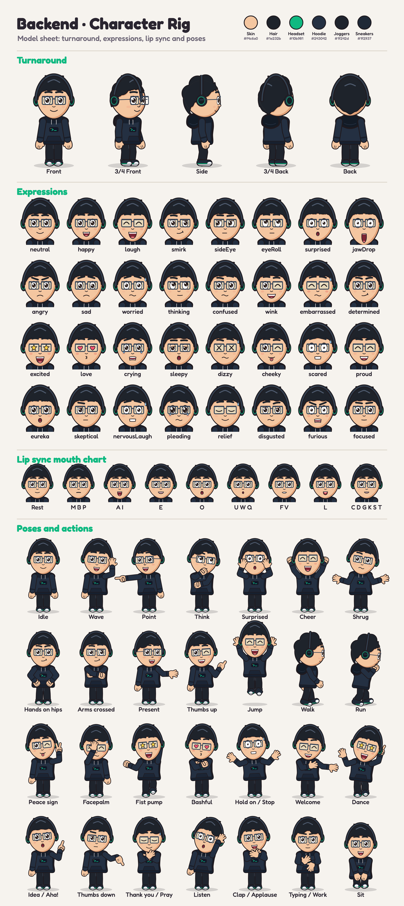

# Backend Programmer: Master Character Rig (`src/assets/character/backend_programmer`)

Rig karakter **Programmer Backend** 2D (vektor SVG) untuk Remotion. Didesain dengan nuansa *dark-mode* dan arsitektur sistem: rambut bertekstur kasual, *over-ear studio headphones* 3D dengan aksen LED *terminal emerald* (`#10b981`), kacamata persegi panjang, hoodie slate-navy lengkap dengan tudung belakang, tali hoodie, kantong kanguru, serta lencana terminal `>_` di dada, celana kargo jogger charcoal, dan *sneakers* beraksen emerald.

Karakter ini memiliki antarmuka props yang **100% kompatibel** dengan [`../man`](../man/README.md) & [`../woman`](../woman/README.md), mendukung **32 ekspresi**, **28 pose**, **24 bentuk mulut (lip-sync)**, dan **5 siklus gerak (`idle`, `still`, `walk`, `run`, `dance`)**.



## Identitas & Panduan Peran (Reusable di Berbagai Plot)

- **Persona & Ciri Visual**: Logis, fokus pada sistem di balik layar, pencinta *dark-mode*, tenang namun ceplas-ceplos atau sedikit sarkastik (rambut bertekstur kasual, headphone studio 3D beraksen LED emerald, kacamata persegi panjang, dan hoodie gelap berlogo terminal `>_`).
- **Cocok digunakan untuk**:
  - **Tutorial Coding Backend & Infrastruktur**: Membahas REST/GraphQL API, database SQL/NoSQL, autentikasi, caching (Redis), Docker, antrean pesan, atau arsitektur server.
  - **Problem Solving & Debugging Sistem**: Menyelidiki server *down*, query lambat (*N+1*), *race condition*, *memory leak*, atau celah keamanan.
  - **Fakta Menarik Sistem & Teknologi**: Cerita di balik skala server besar, cara kerja DNS/enkripsi, insiden *outage* terkenal, dan fakta teknis infrastruktur.
  - **Drama & Sketsa**: Paling cocok menjadi karakter yang bersikeras *"Di laptopku aman kok!"*, panik diam-diam saat database production tersentuh, atau saling lempar bug dengan **Frontend**.
- **Kombinasi Pose & Ekspresi Andalan**:
  - Memberi fakta logis / komentar sarkastik: `pose="armsCrossed"` + `expression="smirk"`
  - Debugging terminal / menulis API: `pose="typing"` + `expression="focused"`
  - Merancang skema database / berpikir keras: `pose="think"` + `expression="thinking"`
  - Server production bermasalah: `pose="shrug"` + `expression="nervousLaugh"` (atau `expression="worried"`)
- **Chemistry Terbaik**: Duet klasik dengan **Frontend Programmer** (perbedaan pola pikir visual vs sistem), atau berhadapan dengan **Bos** saat menjelaskan alasan server butuh *upgrade* atau waktu perbaikan.

## Isi folder

| File | Isi |
| --- | --- |
| `Character.tsx` | Komponen `<Character>` (`BackendProgrammerCharacter`) dengan `Interactive.create` untuk kontrol & keyframe di Remotion Studio. |
| `Head.tsx` | Kepala 3D dengan rambut bertekstur, headphone studio 3D (opsional via `showHeadphones`), dan kacamata persegi panjang (opsional via `showGlasses`). |
| `Body.tsx` | Hoodie dark-mode dengan tudung belakang 3D, tali hoodie, kantong kanguru, lencana terminal `>_` (opsional via `showBadge`), celana kargo, dan sneakers. |
| `rig.ts` | Palet warna `COLORS` dan proporsi `RIG`. |
| `presets.ts` | Re-export 32 ekspresi, 28 pose, dan fungsi blending (`mixFace`, `resolveFace`, `resolvePose`). |
| `motion.ts` | Re-export kedip otomatis, lip-flap, serta siklus `idle`, `walk`, `run`, `dance`. |
| `model-sheet.png` | Model sheet: turnaround 360°, 32 ekspresi, chart mulut, dan 28 pose/aksi. |

## Pemakaian dasar

```tsx
import {Character as BackendProgrammerCharacter} from './assets/character/backend_programmer';
// atau: import {BackendProgrammerCharacter} from '../character';

<BackendProgrammerCharacter
  name="Backend Dev"
  from={0}
  durationInFrames={3 * fps}
  pose="armsCrossed"
  expression="smirk"
  talking
  style={{translate: '880px 120px', scale: 0.9}}
/>
```

## Props khusus karakter

Selain seluruh props standar (`expression`, `pose`, `talking`, `mouth`, `motion`, `yaw`, `headYaw`, `headTilt`, `headNod`, `lookX`, `lookY`, `framing`, `seed`, `style`), tersedia pula opsi berikut:

| Prop | Default | Keterangan |
| --- | --- | --- |
| `showGlasses` | `true` | Tampilkan/sembunyikan kacamata persegi panjang. |
| `showHeadphones` | `true` | Tampilkan/sembunyikan headphone studio 3D. |
| `showBadge` | `true` | Tampilkan/sembunyikan emblem terminal `>_` di dada. |

## Komposisi di Studio (`npm run dev`)

- **Rigs / BackendProgrammerRig**: playground rig untuk mengatur ekspresi, pose, arah hadap, dan properti lainnya di Remotion Studio.
- **ModelSheets / BackendProgrammerModelSheet**: sumber `model-sheet.png`.
