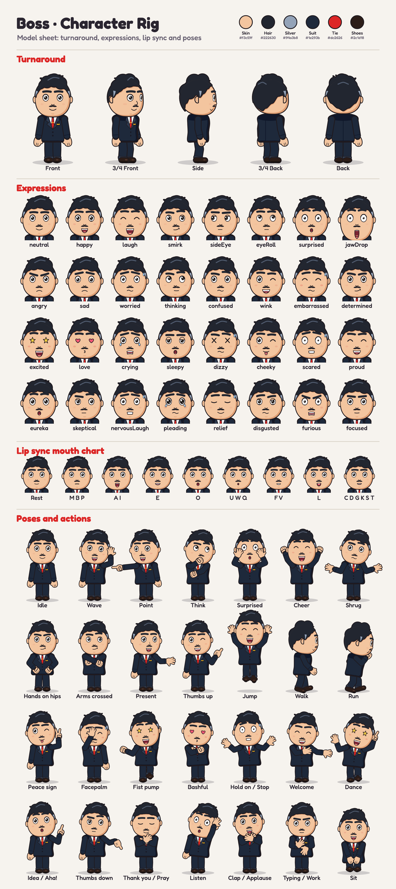

# Boss / Executive: Master Character Rig (`src/assets/character/boss`)

Rig karakter **Bos / CEO Perusahaan Teknologi** 2D (vektor SVG) untuk Remotion. Memiliki postur wajah **rahang kotak yang tegas dan lebar** (*square jaw*), mata tajam dengan alis tebal, rambut disisir ke belakang dengan uban perak di pelipis, kumis rapi eksekutif, serta setelan jas charcoal-navy lengkap dengan kemeja putih, dasi merah, *pocket square* emas, jam tangan emas, dan sepatu pantofel kulit.

Karakter ini terhubung ke [`../shared`](../shared) dengan antarmuka props yang **100% kompatibel** dengan seluruh karakter lainnya, mendukung **32 ekspresi**, **28 pose**, **24 bentuk mulut (lip-sync)**, dan **5 siklus gerak (`idle`, `still`, `walk`, `run`, `dance`)**.



## Identitas & Panduan Peran (Reusable di Berbagai Plot)

- **Persona & Ciri Visual**: Tegas, berwibawa, ambisius, dan selalu berpikir dari sudut pandang target bisnis, kecepatan rilis, dan biaya (rahang kotak lebar yang kuat, mata lebih tajam dengan alis tebal, rambut *slicked-back* beruban perak, kumis rapi, jas charcoal-navy, dasi merah, dan *pocket square* emas).
- **Cocok digunakan untuk**:
  - **Pemicu Konflik di Drama & Sketsa**: Cocok memerankan **Bos / CEO / Manajer / Klien VIP / Investor** yang datang membawa target mendadak (*"Fitur AI-nya bisa kelar besok pagi kan?"*) atau syok melihat tagihan cloud membengkak.
  - **Sudut Pandang Bisnis di Konten Problem Solving**: Membantu menjelaskan *trade-off* antara kualitas teknis, biaya, dan *time-to-market* (kenapa perusahaan tidak selalu memilih teknologi tercanggih).
  - **Narator Fakta Industri & Bisnis Teknologi**: Membahas studi kasus bisnis raksasa teknologi, keputusan produk yang gagal/sukses, atau realita dunia kerja IT.
  - **Penilai Hasil Akhir**: Memberi persetujuan atau tantangan di akhir cerita (*"Bagus, sekarang kita rilis sebelum makan siang!"*).
- **Kombinasi Pose & Ekspresi Andalan**:
  - Memberi perintah / target tegas: `pose="handsOnHips"` + `expression="determined"`
  - Menuntut deadline / marah komedi: `pose="point"` + `expression="angry"` (atau `expression="furious"`)
  - Kaget melihat error / tagihan cloud melonjak: `pose="surprised"` + `expression="jawDrop"`
  - Puas saat proyek rilis dan menguntungkan: `pose="thumbsUp"` + `expression="proud"`
- **Chemistry Terbaik**: Kuat saat memberi tekanan ke **Backend** & **Frontend**, bernegosiasi dengan **Woman** (sebagai Tech Lead/PM), atau berperan sebagai Klien/Investor yang berhadapan dengan **Man**.

## Isi folder

| File | Isi |
| --- | --- |
| `Character.tsx` | Komponen `<Character>` (`BossCharacter`) dengan `Interactive.create` untuk kontrol & keyframe di Remotion Studio. |
| `Head.tsx` | Kepala berpostur rahang kotak tegas, mata eksekutif, alis tebal, rambut *slicked-back* beraksen perak, kumis (opsional via `showMustache`), dan kacamata opsional (`showGlasses`). |
| `Body.tsx` | Jas charcoal-navy dengan kerah lapel, kemeja putih, dasi merah + penjepit emas, *pocket square*, jam emas, celana bahan, dan sepatu pantofel. |
| `rig.ts` | Palet warna `COLORS` dan proporsi tubuh eksekutif `RIG`. |
| `presets.ts`, `motion.ts` | Re-export preset ekspresi/pose dan siklus gerak dari `../shared`. |
| `model-sheet.png` | Model sheet: turnaround 360°, 32 ekspresi, chart mulut, dan 28 pose/aksi. |

## Pemakaian dasar

```tsx
import {Character as BossCharacter} from './assets/character/boss';
// atau: import {BossCharacter} from '../character';

<BossCharacter
  name="Bos"
  from={0}
  durationInFrames={3 * fps}
  pose="handsOnHips"
  expression="determined"
  talking
  style={{translate: '540px 120px', scale: 0.9}}
/>
```

## Props khusus karakter

| Prop | Default | Keterangan |
| --- | --- | --- |
| `showMustache` | `true` | Tampilkan/sembunyikan kumis eksekutif. |
| `showGlasses` | `false` | Tampilkan/sembunyikan kacamata *half-rim*. |

## Komposisi di Studio (`npm run dev`)

- **Rigs / BossRig**: playground rig untuk mencoba ekspresi, pose, dan properti Bos di Remotion Studio.
- **ModelSheets / BossModelSheet**: sumber `model-sheet.png`.
