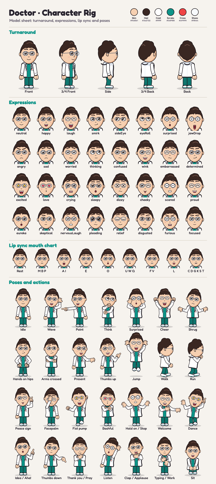

# Doctor: Diagnostic Analogy Character Rig (`src/assets/character/doctor`)

Rig karakter **Dokter** 2D (vektor SVG) untuk Remotion, dirancang khusus untuk **perumpamaan (*analogy*) dalam video tutorial & problem solving teknologi** (misalnya *system health check*, diagnosis akar bug, *memory leak checkup*, *antivirus/security*, atau *performance profiling*) maupun sketsa cerita.

## Identitas & Panduan Peran (Reusable di Berbagai Plot)

- **Persona & Ciri Visual**: Tenang, teliti, analitis, dan menenangkan—memiliki **postur wajah tirus rapi & lebih panjang**, kacamata oval tipis, rambut belah samping rapi, jas lab/dokter putih di atas seragam *scrubs* teal, stetoskop 3D di leher, dan saku berlogo palang medis.
- **Cocok digunakan untuk**:
  - **Perumpamaan Debugging & Problem Solving**: Menganalogikan **profiling performa**, **memory leak**, **error logs**, atau **system health check** layaknya pemeriksaan dokter terhadap pasien (aplikasi/server).
  - **Perumpamaan Keamanan / Antivirus**: Menjelaskan konsep *firewall*, *patch kerentanan*, atau *karantina malware* sebagai imunisasi/pengobatan sistem.
  - **Tutorial & Fakta Menarik**: Menguraikan "gejala → diagnosis → resep solusi" saat aplikasi lambat atau sering *crash*.
  - **Drama & Sketsa**: Pemeriksa kesehatan mental/fisik developer yang begadang karena *deadline*, atau karakter metafora yang memeriksa "server yang sakit".
- **Kombinasi Pose & Ekspresi Andalan**:
  - Memeriksa gejala / mendengarkan keluhan: `pose="think"` + `expression="thinking"`
  - Menemukan akar penyebab (*root cause*): `pose="idea"` + `expression="eureka"`
  - Memberikan resep / solusi teknis: `pose="present"` + `expression="happy"` + `talking`
  - Kondisi darurat sistem kritis: `pose="stop"` + `expression="worried"`
- **Chemistry Terbaik**: Efektif dipasangkan dengan **Backend Programmer** (memeriksa server yang "sakit") atau **Man** (sebagai pasien/aplikasi yang mengalami keluhan).

## Props khusus karakter

| Prop | Default | Keterangan |
| --- | --- | --- |
| `showGlasses` | `true` | Tampilkan/sembunyikan kacamata oval tipis. |
| `showStethoscope` | `true` | Tampilkan/sembunyikan stetoskop di leher. |
