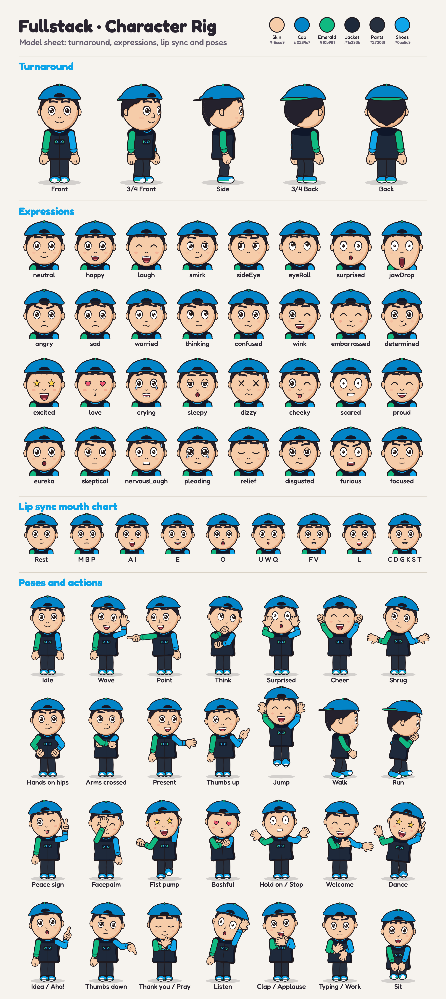

# Fullstack Programmer: Dual-Stack Character Rig (`src/assets/character/fullstack_programmer`)

Rig karakter **Fullstack Programmer** 2D (vektor SVG) untuk Remotion. Memiliki **postur wajah oval lebih lebar dan enerjik**, topi *baseball* 3D yang dipakai terbalik (*backwards cap*) warna cyan & emerald, serta jaket raglan *dual-tone* (lengan cyan ala Frontend + lengan emerald ala Backend) dengan emblem `{</>}` di dada.

## Identitas & Panduan Peran (Reusable di Berbagai Plot)

- **Persona & Ciri Visual**: Enerjik, serba bisa, fleksibel menangani tampilan sampai server—mudah dikenali dari topi *snapback* terbalik, wajah bulat-oval ceria, serta warna kombinasi Frontend (cyan) & Backend (emerald).
- **Cocok digunakan untuk**:
  - **Tutorial End-to-End / Fullstack App**: Membahas Next.js, T3/MERN, Prisma, integrasi Frontend ↔ API ↔ Database, hingga *deployment*.
  - **Problem Solving Lintas Layer**: Menjelaskan bug yang melibatkan dua sisi sekaligus (misalnya validasi form, autentikasi JWT/session, atau optimasi full-pipeline).
  - **Fakta Menarik Dunia Dev**: Perbandingan peran solo dev, startup indie, atau tren *framework* modern.
  - **Drama & Sketsa**: Menjadi "karyawan serba bisa" yang sering dititipi tugas dari semua divisi atau menjadi penengah teknis saat Frontend & Backend saling lempar tanggung jawab.
- **Kombinasi Pose & Ekspresi Andalan**:
  - Semangat bikin aplikasi dari nol: `pose="fistPump"` + `expression="excited"`
  - Kewalahan mengurus UI sekaligus server: `pose="shrug"` + `expression="dizzy"` (atau `expression="nervousLaugh"`)
  - Presentasi fitur *end-to-end*: `pose="present"` + `expression="happy"` + `talking`
  - Ngoding maraton: `pose="typing"` + `expression="focused"`
- **Chemistry Terbaik**: Efektif dipasangkan dengan **Frontend** dan **Backend** (sebagai jembatan keduanya), atau dengan **Bos/PM** sebagai andalan tim saat *resource* terbatas.

## Props khusus karakter

| Prop | Default | Keterangan |
| --- | --- | --- |
| `showCap` | `true` | Tampilkan/sembunyikan topi *backwards cap*. |
| `showBadge` | `true` | Tampilkan/sembunyikan emblem `{</>}` di dada. |
