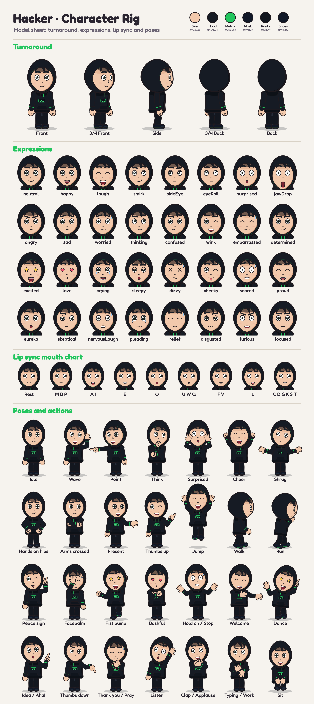

# Hacker: Cybersecurity & Stealth Character Rig (`src/assets/character/hacker`)

Rig karakter **Hacker** 2D (vektor SVG) untuk Remotion. Memiliki **postur wajah tirus runcing (*V-shape*) yang misterius**, tudung hoodie gelap dinaikkan 3D beraksen *matrix-green* (`hoodUp`), rambut poni gelap di bawah bayangan tudung, opsi masker siber (`showMask`), tali hoodie hijau neon, serta lencana biner `01` di dada.

## Identitas & Panduan Peran (Reusable di Berbagai Plot)

- **Persona & Ciri Visual**: Misterius, cerdik, fokus pada celah keamanan dan *exploit*—mudah dikenali dari wajah V-shape tirus, hoodie hitam dengan tudung naik beraksen *matrix-green* `#22c55e`, serta opsi masker siber.
- **Cocok digunakan untuk**:
  - **Tutorial & Edukasi Cybersecurity**: Membahas *SQL Injection*, *XSS*, *CSRF*, enkripsi, *password hashing*, *brute force*, *phishing*, hingga cara kerja *JWT/OAuth* yang aman.
  - **Perumpamaan Ancaman di Problem Solving**: Memvisualisasikan "penyerang" yang mencoba menerobos sistem yang belum divalidasi atau lupa pakai *rate limiter*.
  - **Fakta Menarik Dunia Keamanan Siber**: Cerita peretasan terkenal, *bug bounty*, atau trik rekayasa sosial (*social engineering*).
  - **Drama & Sketsa**: Antagonis komedi / *ethical hacker (pentester)* yang menguji ketahanan sistem buatan **Backend** & **Frontend** sebelum rilis.
- **Kombinasi Pose & Ekspresi Andalan**:
  - Menyusun rencana serangan / demo *exploit*: `pose="armsCrossed"` + `expression="smirk"`
  - Mengetik cepat di terminal gelap: `pose="typing"` + `expression="focused"`
  - Berhasil menembus celah keamanan: `pose="point"` + `expression="cheeky"` (atau `expression="laugh"`)
  - Terkena *firewall* / patch keamanan: `pose="surprised"` + `expression="scared"`
- **Chemistry Terbaik**: Lawan alami bagi **Backend Programmer** dan **Doctor** (dalam metafora pertahanan/imunitas sistem), atau bekerja sama dalam sketsa *ethical hacking* bersama **Tech Lead**.

## Props khusus karakter

| Prop | Default | Keterangan |
| --- | --- | --- |
| `hoodUp` | `true` | Naikkan tudung hoodie (`true`) atau turunkan untuk melihat rambut penuh (`false`). |
| `showMask` | `false` | Tampilkan/sembunyikan masker siber stealth (default `false` agar lip-sync mulut tetap terlihat). |
| `showBadge` | `true` | Tampilkan/sembunyikan emblem `01` di dada. |
