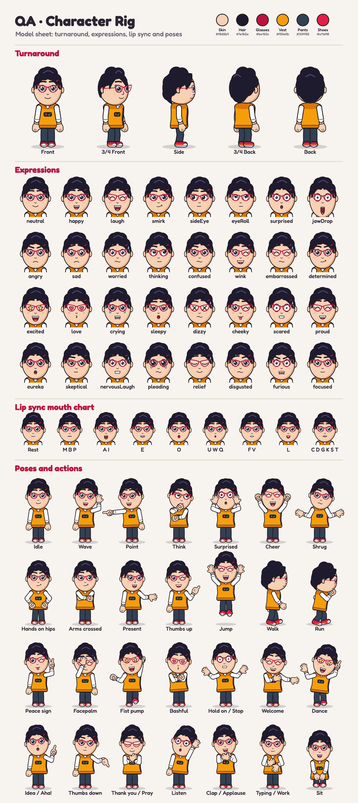

# Quality Assurance (QA): Bug-Hunter Character Rig (`src/assets/character/quality_assurance`)

Rig karakter **Quality Assurance (QA)** 2D (vektor SVG) untuk Remotion. Memiliki **postur wajah persegi-ramping yang tajam & observan**, rambut bob rapi berjepit merah, kacamata *cat-eye* crimson, rompi rajut mustard di atas kemeja putih berkerah, serta lencana ikon bug & tanda centang hijau di dada.

## Identitas & Panduan Peran (Reusable di Berbagai Plot)

- **Persona & Ciri Visual**: Teliti, kritis, jeli melihat celah sekecil apa pun, dan jujur soal kondisi aplikasi—ditandai postur wajah tajam, kacamata *cat-eye* merah, rompi kuning mustard, dan lencana bug + centang.
- **Cocok digunakan untuk**:
  - **Drama & Sketsa Rilis**: Muncul 10 menit sebelum *deploy* Jumat sore sambil membawa temuan 20 bug kritis untuk **Frontend**, **Backend**, atau **Fullstack**.
  - **Tutorial Testing & Kualitas Kode**: Membahas *unit test*, *integration test*, *E2E testing* (Playwright/Cypress), *edge cases*, atau *regression testing*.
  - **Problem Solving Bug Aneh**: Menjelaskan bagaimana user melakukan input tak terduga yang membuat sistem error.
  - **Fakta Menarik Software Bugs**: Menceritakan bug legendaris dunia teknologi atau pentingnya *testing* sebelum rilis.
- **Kombinasi Pose & Ekspresi Andalan**:
  - Menemukan bug mencurigakan: `pose="think"` + `expression="sideEye"` (atau `expression="skeptical"`)
  - Menahan proses rilis (*"Belum lulus QA!"*): `pose="stop"` + `expression="determined"`
  - Menunjukkan laporan bug / checklist: `pose="point"` + `expression="smirk"`
  - Semua test hijau / lolos uji: `pose="thumbsUp"` + `expression="proud"`
- **Chemistry Terbaik**: Lawan tanding yang seru bagi **Backend** (yang bilang *"di lokal jalan"*) dan **Frontend**, sekaligus sekutu terdekat **Tech Lead** saat menjaga kualitas rilis.

## Props khusus karakter

| Prop | Default | Keterangan |
| --- | --- | --- |
| `showGlasses` | `true` | Tampilkan/sembunyikan kacamata *cat-eye*. |
| `showBadge` | `true` | Tampilkan/sembunyikan lencana bug & centang QA. |
