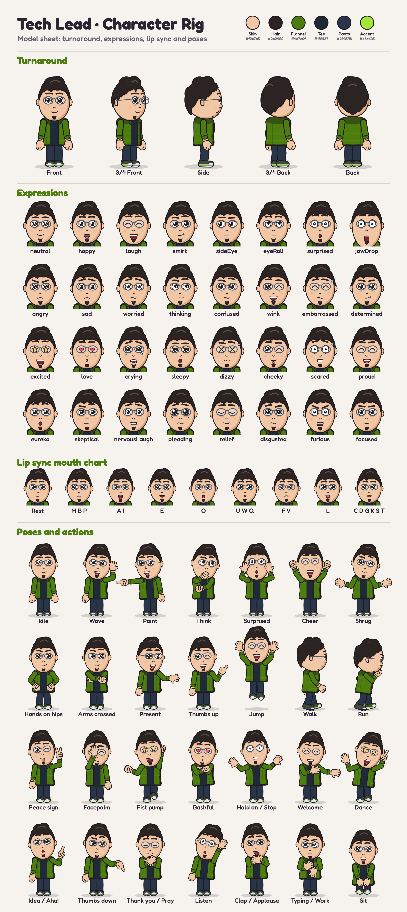

# Tech Lead: Senior Architect Character Rig (`src/assets/character/tech_lead`)

Rig karakter **Tech Lead** 2D (vektor SVG) untuk Remotion. Memiliki **postur wajah lebih panjang, tirus, dan angular** dengan garis lelah tipis di bawah mata, janggut kecil (*goatee*), kacamata tipis, serta kemeja flanel olive terbuka di atas kaos hitam.

## Identitas & Panduan Peran (Reusable di Berbagai Plot)

- **Persona & Ciri Visual**: Bijaksana, berpengalaman, realistis, agak lelah karena kebanyakan *meeting* dan *code review*—mudah dikenali lewat postur wajah tirus panjang, janggut dagu, kacamata tipis, dan kemeja flanel lengan digulung.
- **Cocok digunakan untuk**:
  - **Mentor Arsitektur & Best Practices**: Menjelaskan *system design*, *clean code*, *refactoring*, atau alasan di balik pemilihan arsitektur tertentu.
  - **Problem Solving Kompleks**: Melakukan *root-cause analysis*, *code review*, dan meredam krisis produksi.
  - **Fakta Menarik & Pengalaman Senior**: Membahas "kenapa keputusan teknis sederhana sering lebih baik daripada over-engineering".
  - **Drama & Sketsa**: Penengah paling sabar antara **Bos/PM** yang mengejar deadline dengan **Frontend/Backend/Fullstack** yang sedang berdebat.
- **Kombinasi Pose & Ekspresi Andalan**:
  - Menghela napas melihat *spaghetti code*: `pose="facepalm"` + `expression="relief"` (atau `expression="disgusted"`)
  - Mengevaluasi solusi teknis dengan tenang: `pose="think"` + `expression="thinking"`
  - Menjelaskan desain arsitektur ke tim: `pose="present"` + `expression="determined"` + `talking`
  - Melarang *force push* ke `main`: `pose="stop"` + `expression="angry"`
- **Chemistry Terbaik**: Efektif menjadi penasihat teknis **Boss / PM** dan pembimbing bagi **Frontend**, **Backend**, serta **Fullstack**.

## Props khusus karakter

| Prop | Default | Keterangan |
| --- | --- | --- |
| `showGlasses` | `true` | Tampilkan/sembunyikan kacamata oval tipis. |
| `showGoatee` | `true` | Tampilkan/sembunyikan janggut dagu. |
| `showUnderEyeBags` | `true` | Tampilkan/sembunyikan garis kantung mata lelah. |
